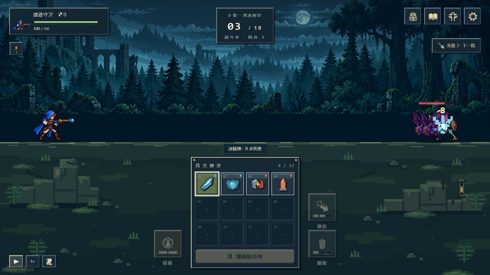
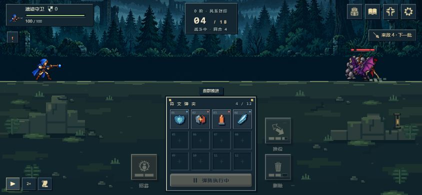

# 第二轮试玩调整 · v0.2.1

2026-10-27，按用户四条试玩反馈更新。

## 战斗画面

五系弹道使用整数网格绘制的不同轮廓：火焰弹、水滴、闪电、风刃与岩块。命中由短闪、展开、碎片散落三个阶段构成；取消圆环与文字符号爆炸，击破时扩大范围。特效显示在怪物之上，手机横屏缩小尺寸；遵守系统减少动态效果偏好。

敌群普通前进合并播放，保留步伐与尘土。近战前扑、远程抬手和敌方向左弹道、治疗与鼓舞使用不同表现。原结算顺序和日志不变；反击击退会切分推进组，保证先被推退、再受战鼓推动的两段位移均可见。统一逻辑时钟让暂停、切倍速和打开面板后动作保持原进度。

## 进化羁绊

第 4、9、15 批的进化候选仍要求当前元素数量达标，但不再要求事先持有核心弹。选择时若缺 targetId 对应子弹，使用常规实例创建路径赠送一枚；已有同名弹不新增。正常计时、入夹权重和存档规则适用。跳过、刷新不赠送，禁用元素不能出现，激活要求仍完整保留。候选和详情明确显示赠送提示。

## 平衡

新局使用遭遇版本 3；已有版本 1/2 局的敌人和后续波次原样保留。

| 项目（难度 0） | 调整前 | 调整后 |
| --- | --- | --- |
| 完整远征敌人数 | 76 | 101 |
| 普通波总生命 | 2160 | 1943 |
| 虫群分阶段生命 | 12 / 18 / 27 | 5 / 8 / 11 |
| 虫群攻击 | 3 | 1 |
| 三位首领生命 | 162 / 288 / 522 | 146 / 260 / 470 |

首两波普通怪攻击减 1，后续普通怪攻击保留，首领攻击减 1。其他普通怪的单体生命不会超过同难度旧版；升阶生命、攻击和护盾增量继续生效。

固定自动选牌策略，无天赋、无换位、无预知随机数，每个版本各 100 种子：难度 0 胜局 60 → 77，通关平均剩余生命 59.28 → 65.87，平均击杀 72.99 → 99.59。难度 5/10 的同一弱策略仍无法通关。模拟仅用于比较趋势，并非真实玩家胜率；新增击杀收入与出怪消耗随机数会影响后续候选。详细数据见 [600 局结果](balance-simulation-2026-10-27.json)，复现命令：`node scripts/compare-balance.mjs 100`。

## 验证

- 全套 369 项测试通过，包括全部 8 条进化的赠弹、重复选择、跳过、禁用、存储与入夹。
- 新旧战斗状态独立对照相同；混合反击、鼓手、治疗、死亡中断的移动边界检查通过。
- 29 个运行文件及 194 个素材通过 HTTP、MIME、子路径与构建文件逐字节检查。
- 桌面和 844×390 横屏浏览器实测：像素命中、同时推进、暂停后切倍速、远程攻击及跨回合补给；未见控制台错误。

