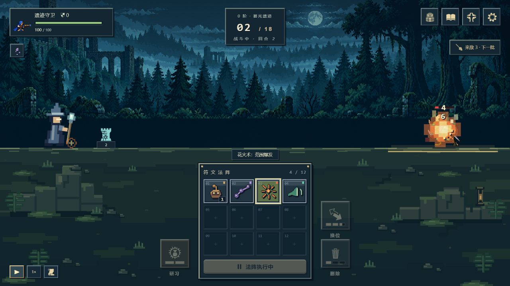
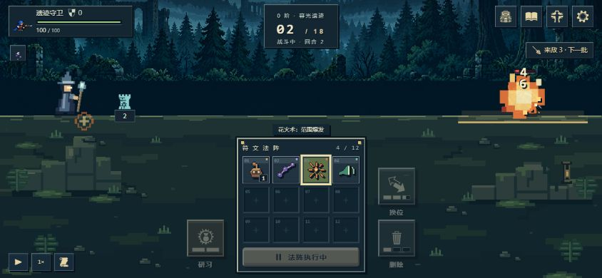

# v0.3.0 魔法构筑验收

2026-10-28 完成。机制与收益见 [机制审查](magic-mechanics-audit-2026-10-28.md)，遭遇与固定种子模拟见 [平衡报告](magic-swarm-balance-2026-10-28.md)。

- 全套 Node 测试 406/406 通过，包括爆炸实际覆盖与边界、死亡钩子不复活、蓄力周期、永久卷轴跨回合与读档、旧版本遭遇保留、奖励与文字交叉校验。
- 静态构建通过；31 个运行文件及 194 个素材通过仓库子路径、MIME 和源码/发布字节一致性检查。临时视觉验收页已移除，没有进入发布包。
- 浏览器实际操作验证：旧测试存档从第2批继续；新局随机封印可跳过；四枚起手、布阵、两轮战斗、羁绊跳过、第三批6怪可正常执行。
- 1280×720 桌面与 844×390 横屏检查范围爆炸、伤害数字、法阵及操作入口；暂停/继续保持特效进度。保留原本红色连续血条及无数字状态图标。
- 图鉴用旧名“火药桶”检索得到新名“炎爆咒”，输入值保持原样，卡面显示爆炸范围、40主伤/20范围伤与蓄力说明。浏览器无错误或警告。
- 像素法师抬杖与披风、低阶小法术、高阶火焰/潮浪/落雷/风旋/岩柱分别显示；强化效果使用额外法印。造物攻击与召唤生成分别处理，保留命中伤害数字。

研究：参考 [Deep Rock Galactic: Survivor 官方更新](https://steamcommunity.com/app/2321470/announcements/?l=english) 对爆炸范围与伤害的独立调整，以及 [Roboquest 官方更新](https://store.steampowered.com/news/posts/?appids=692890&enddate=1645199875&feed=steam_community_announcements) 对爆炸半径、冷却与伤害的分别取舍。本项目采用这些设计思路，具体规则由自身回合制与水平距离模型决定。

示例截图为本地真实界面，不代表真人通关难度已经完成长期平衡。新出怪规则用于新远征，旧局保留原遭遇版本；法术增强对旧局也生效，当前剩余蓄力计数保持，之后重置使用新周期。永久指本局内，同名其他实例不会同步增强。

